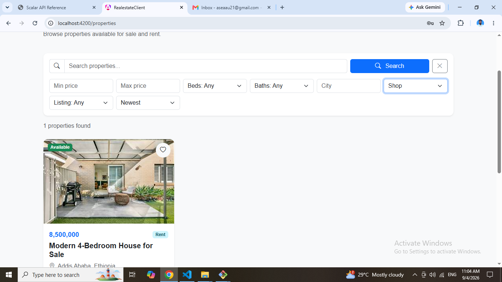
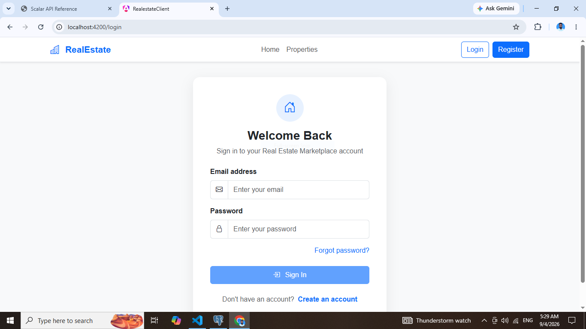
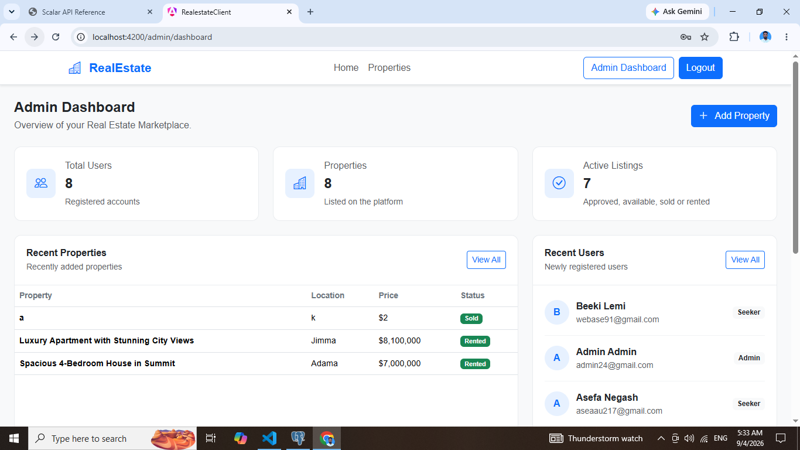
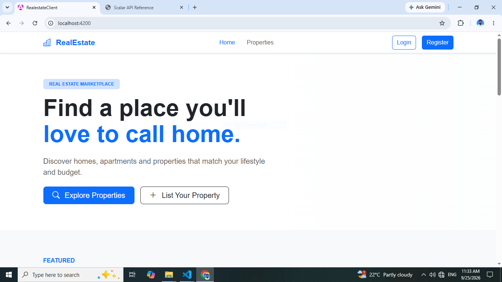
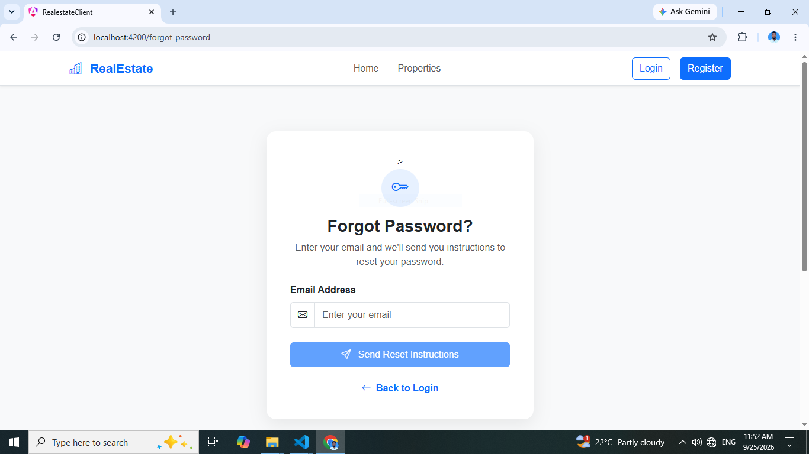

# RealEstateClient

A modern real-estate marketplace frontend for discovering listings and managing property activity. Built with Angular, it includes public property browsing, signed-in user workspaces, administration tools, and real-time conversations.

## Screenshots

| User dashboard | Property search |
| --- | --- |
|  |  |

| Search page | My properties |
| --- | --- |
|  |  |

| Login | Conversations |
| --- | --- |
|  |  |

| Admin | Application view |
| --- | --- |
|  |  |

| Additional application view |
| --- |
|  |

## Features

- Browse, search, filter, sort, and view property listings.
- Register and sign in; recover or reset a password.
- Create and edit listings, and manage favorites and profile information.
- User dashboard with personal listings, notifications, and conversations.
- Send messages with real-time updates over SignalR.
- Admin dashboard for users, properties, and reports.
- Route-level authentication and admin access guards.

## Technology

| Area | Stack |
| --- | --- |
| Frontend | Angular 21, TypeScript, RxJS |
| UI | SCSS, Bootstrap 5, Bootstrap Icons |
| API and real-time | Angular `HttpClient`, SignalR |
| Tests | Vitest through Angular CLI |

## Application structure

Standalone page components are lazy-loaded by the Angular router. Feature pages use shared services to call the REST API; the messaging area also connects to a SignalR hub.

```text
src/app/
├── features/       # Property browsing, auth, user workspace, admin, reviews
├── layout/         # Navigation and footer
├── shared/         # Reusable UI components and utilities
├── services/       # REST and SignalR integrations
├── models/         # API and view data types
├── guards/         # Authentication and admin route guards
└── interceptors/   # HTTP authentication
```

## API configuration

The frontend uses the API base URL in `src/environments/environment.ts` and `src/environments/environment.development.ts`. Both currently point to `http://localhost:5131/api/v1`; update the relevant file for your backend. The chat client derives its SignalR endpoint at `/hubs/chat` from that API URL.

## Getting started

**Requirements:** Node.js and npm.

```bash
npm install
npm start
```

Open [http://localhost:4200](http://localhost:4200). The configured backend must be running and reachable at the API URL above.

```bash
npm run build   # Production build
npm test        # Unit tests
```
